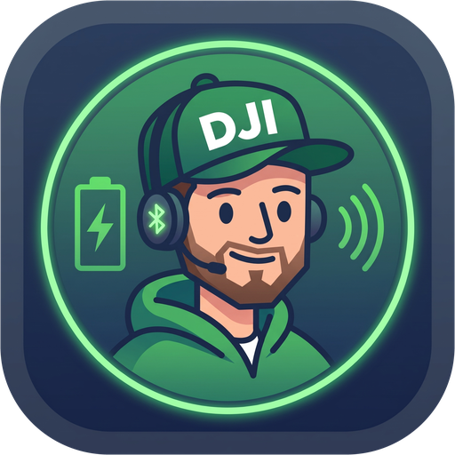

  

<h1 align="center">DJI Homie</h1>

  Local Bluetooth control of DJI Power stations from Android: no DJI cloud, no internet needed day to day.

  
  
  
  

## Features

### 🔌 Local control, no cloud
- Talks to the station directly over Bluetooth, using the same encrypted protocol as DJI Home.
- Signs in to your DJI account **once**, to fetch the station's local pair key, which is
  stored encrypted on your device. DJI's captcha and two-step email codes are handled in-app.
  After that, everything runs locally.
- Finds nearby stations automatically, identifies the model, and reconnects if the link drops.

### 📊 Live dashboard
- Battery level, input and output power, AC and DC output, and time to full or empty.
- Power draw per output, with on/off switches for every output the station has.
- Bluetooth signal meter, connection status, and the station's health alarms.
- History charts of battery level and power over time.

### ⚡ Energy management
- Discharge and charge limits on one range slider.
- Custom backup reserve: only solar charges above it, all sources charge below it.
- Energy Saver modes, including **Scheduled Periods**: peak and off-peak price periods
  by day and time, discharge at peak, charge off-peak, and off-peak charging power.
- Controls for DJI's Super Fast Car Chargers: on/off, mode, and power and voltage limits.

### ⚙️ Station settings
- UPS mode (AC always on), screen timeout, device auto-off, and °C/°F.
- Device details: firmware and dongle versions, cycle count, connected accessories
  (such as the solar MPPT adapter), and expansion batteries.

### 🤖 Built-in automations
These run on your Android device, in the background **only** while one of them is switched on.

| Automation | What it does |
|---|---|
| Zero-load cutoff | Switches AC off after it has sat idle, so the inverter stops wasting power. |
| Battery cutoff | Switches AC off at a set battery level, keeping a reserve for DC and USB. |
| Duty cycle | Runs AC for N minutes of every period. |
| Solar priority | Runs AC only while charge input is above a threshold. |
| Storm prep | Watches US National Weather Service alerts for your area and charges to 100% during a hurricane or tropical-storm alert, then restores your previous limit. |

### 🏠 Home Assistant over MQTT
Point the app at your MQTT broker (for example the Mosquitto app in Home Assistant).
Through MQTT discovery, a **DJI Power** device appears in Home Assistant automatically, with:
- live sensors (battery, power in/out, AC/DC power, time remaining, charging);
- a switch for every output;
- every setting above as a Home Assistant control, plus DJI Homie's automations and their thresholds;
- station alarms as HA events, and Bluetooth signal and station connection as diagnostics.

The app shows whether MQTT is connected and sending, and reconnects on its own.

| Topic | Purpose |
|---|---|
| `<base>/state` | Telemetry JSON (retained) |
| `<base>/settings` | Every setting as JSON (retained) |
| `<base>/set/<id>` | Commands (`ON`/`OFF`, numbers, option names) |
| `<base>/ac/set` | AC on/off (`on`/`off`) |
| `<base>/alarm` | Station alarm events |
| `<base>/availability` | `online` / `offline` (also the last will) |

`<base>` defaults to `dji_power`.

### 📱 Around your device
- **Home-screen widget** with battery, power in and out, and time remaining.
- **Quick Settings tile** to toggle AC from the notification shade.
- **Tasker and MacroDroid**: send the broadcast `com.djipower.companion.SET_AC` with a
  boolean extra `on` and the string extra `token` shown in the app's Automations screen.
  The app also broadcasts `com.djipower.companion.EVENT` with `event` = `LOW_BATTERY` or `GRID_LOST`.
- **Start on boot**: resumes MQTT and automations after a restart. The service also
  comes back by itself after app updates.
- Light, dark or system theme.

### One connection at a time
A DJI Power station accepts **one Bluetooth connection at a time**. While DJI Homie
is connected, the DJI Home app can't connect over Bluetooth, and the other way round.

## Supported hardware

| Model | Status |
|---|---|
| DJI Power 1000 (original) | ✅ Fully tested |
| DJI Power 1000 V2 | Supported, untested |
| DJI Power 1000 Mini | Supported, untested |
| DJI Power 2000 | Supported, untested |
| DJI Power Auro 2000 Elite | Supported, untested |

Scheduled Periods and car-charger controls are implemented from the DJI Home app and
the reference integrations but haven't been tested on hardware yet.
[Reports](https://github.com/xTopher1049/DJI-Homie/issues) are very welcome.

> **Unofficial project. Not affiliated with, endorsed by, or connected to DJI or
> SZ DJI Technology Co., Ltd.** "DJI" is a trademark of its owner and is used here
> only to describe compatibility. This app talks to hardware you own, for
> interoperability. Provided **with no warranty**; see the License. A power
> station is a high-energy device, and you are responsible for safe use.

## Install

Download the APK from the [latest release](https://github.com/xTopher1049/DJI-Homie/releases/latest)
and sideload it (allow "install unknown apps" for your browser or file manager).
Android 8.0 or newer with Bluetooth LE is required.

## Getting your pair key

The app's first-run setup signs in to your DJI account, fetches the pair key, scans
Bluetooth for your station, and stores both encrypted on your device. The account is
never used again.

To get the key for something else (such as a Home Assistant Bluetooth integration),
run `tools/dji_get_pair_key.py` on any computer. It does the same sign-in and prints
the 32-character key.

## Building

**In the cloud:** every push to `main` builds a debug APK with GitHub Actions
(`.github/workflows/build.yml`) and runs the protocol unit tests. Download the APK
from the run's **Artifacts**. Publishing a GitHub Release tagged `vX.Y.Z` builds
version `X.Y.Z` and attaches `DJI-Homie-vX.Y.Z.apk` to the release. To rebuild an
existing release, run the workflow manually (**Actions → Build APK → Run workflow**)
with its tag.

**Locally:** open the project in Android Studio (JDK 17) and run it, or use
`./gradlew testDebugUnitTest assembleDebug`.

## How it works

| Path | Role |
|---|---|
| `protocol/Duml.kt` | DUML framing, CRC8/CRC16, AES-256-CBC transport |
| `protocol/Report.kt` | Telemetry parsing |
| `protocol/Energy.kt`, `Advanced.kt` | Keyed config records: limits, reserve, Energy Saver, schedules, car chargers |
| `ble/DjiPowerDevice.kt` | GATT client, pair-key authentication, serialised request/response, auto-reconnect |
| `data/Conn.kt` | Process-wide connection and live state shared by the UI, service, widget and tile |
| `service/` | Background service, automations, storm monitor, MQTT bridge and Home Assistant entities |
| `cloud/DjiCloud.kt` | One-time account sign-in and pair-key fetch |

Developer notes live in [`docs/HANDOFF.md`](docs/HANDOFF.md), and protocol findings from
the DJI Home app are in [`docs/apk-analysis.md`](docs/apk-analysis.md).

## Support

DJI Homie is free and open source. If it's useful to you, you can
[buy me a coffee](https://buymeacoffee.com/xtopher) ☕

## License

MIT. See [LICENSE](LICENSE). No warranty; use at your own risk.
